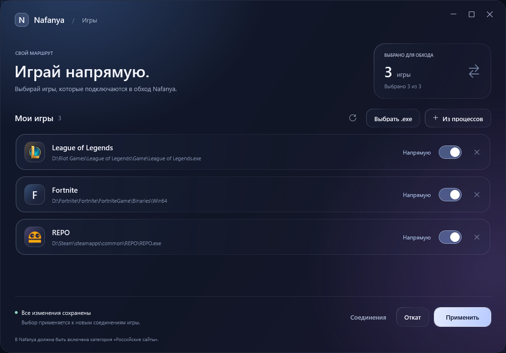
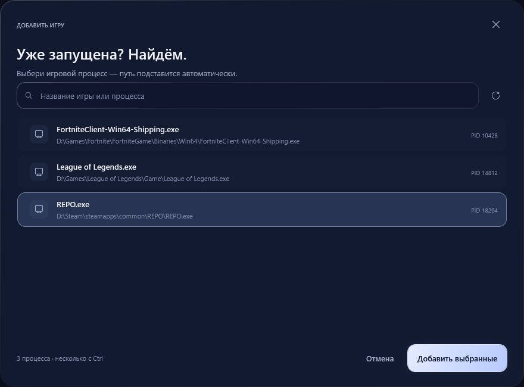

<div align="center">

# Nafanya Game Bypass

Выбирайте игры, которые подключаются напрямую при работающей Nafanya.

[](https://github.com/mifoxti/nafanya-game-bypass/releases/latest)


[](LICENSE)

[**Скачать для Windows**](https://github.com/mifoxti/nafanya-game-bypass/releases/latest) · [Как пользоваться](#быстрый-старт) · [Для разработчика](docs/INTEGRATION.md)

</div>



Небольшой менеджер для Windows, который добавляет в Nafanya правила Direct по пути к игровому исполняемому файлу. Выберите нужные игры, нажмите **«Применить»** и создайте новое подключение к игре.

Стеклянные панели, мягкие блики и анимированные переключатели объединены в тёмном WPF-интерфейсе. На Windows 11 используется системный фон Acrylic.

## Возможности

- **Выбор из процессов.** Найдите запущенную игру по имени. Менеджер подставит полный путь к её `.exe`.
- **Добавление файла.** Выберите игровой исполняемый файл, даже если игра сейчас закрыта.
- **Отдельный переключатель для каждой игры.** Сохранение выбора и отображение несохранённых изменений.
- **Проверка соединений.** Для активных игр видно, сколько соединений используют Direct.
- **Резервная копия и откат.** Перед каждым применением сохраняются текущие правила и выбор игр.
- **Обновление без переподключения.** Локальный набор правил подхватывается установленным sing-box.

## Быстрый старт

1. Скачайте `NafanyaGameBypass-v0.1.0-win-x64.zip` из [последнего релиза](https://github.com/mifoxti/nafanya-game-bypass/releases/latest) и распакуйте.
2. Подключите Nafanya и включите категорию **«Российские сайты»**.
3. Запустите `NafanyaGameBypass.exe`. Windows запросит права администратора для записи файла правил Nafanya.
4. Нажмите **«Из процессов»** или **«Выбрать .exe»**, затем отметьте нужные игры.
5. Нажмите **«Применить»**. Для уже открытой игры создайте новое соединение или перезапустите её.

Во время игры откройте **«Соединения»**, чтобы проверить выбранный выход.

<details>
<summary><strong>Окно выбора процессов</strong></summary>



Поиск работает по имени и полному пути. Несколько процессов можно выбрать с Ctrl. На изображении показаны демонстрационные записи.

</details>

## Совместимость и границы

Проверено с **Windows 11**, **Nafanya VPS 5.3.0** и **sing-box 1.12.10** в режиме **Rule**.

> Для текущей реализации нужна включённая категория **«Российские сайты»**. Менеджер использует её локальный набор `geoip-ru.srs`, подключённый к выходу Direct.

Правила действуют на новые соединения. Снятие переключателя возвращает приложение к обычным правилам Nafanya, включая существующие правила обхода по странам и доменам.

Обновление Nafanya может заменить набор GeoIP. В этом случае откройте менеджер, обновите список и снова нажмите **«Применить»**. Перед записью проверяется совместимость текущей конфигурации.

DNS обрабатывает действующая конфигурация Nafanya. Другой VPN со своими маршрутами может влиять на физический выход Direct. Задержка в игре зависит от сети и сервера.

Установка клиента поддерживается по стандартному пути `C:\Program Files\Nafanya VPS`. Игры можно добавлять из любых доступных каталогов.

## Как это устроено

Менеджер читает локальную конфигурацию Nafanya и находит набор `geoip-ru`, направленный в Direct. Затем он обновляет только созданные им условия `process_path_regex`, сохраняя остальные записи набора.

Перед применением новый набор компилируется установленным sing-box и декомпилируется обратно для проверки. Запись выполняется с блокировкой файла и проверкой контрольной суммы. При ошибке проверки выполняется возврат предыдущего набора.

Выбор игр и резервные копии хранятся в `%LOCALAPPDATA%\NafanyaGameBypass`. Секрет локального API используется в памяти для запросов к `127.0.0.1`. Репозиторий содержит исходники менеджера и изображения интерфейса.

## Сборка

Нужны Windows и установленный **.NET Framework 4.8**. Сборка использует системный компилятор C# и библиотеки WPF.

```powershell
git clone https://github.com/mifoxti/nafanya-game-bypass.git
cd nafanya-game-bypass
.\build.ps1
.\bin\NafanyaGameBypass.exe
```

Основная логика находится в [RuleManager.cs](src/RuleManager.cs), интерфейс — в [MainWindow.xaml](src/MainWindow.xaml), общая тема — в [GlassTheme.xaml](src/GlassTheme.xaml).

Для интеграции выбора игр в Nafanya подготовлено [описание архитектуры и проверок](docs/INTEGRATION.md).

## Лицензия

[MIT](LICENSE) · © 2026 [mifoxti](https://github.com/mifoxti)
